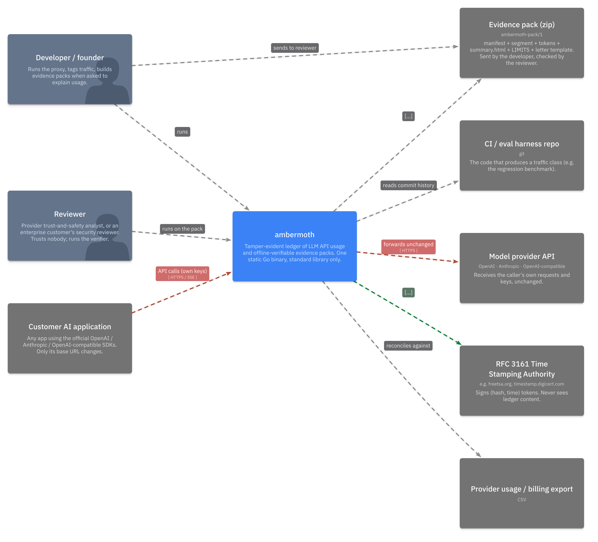

<p align="center">
  
</p>

<p align="center">
  <a href="https://github.com/devrdias/ambermoth/actions"></a>
  
  
  
  <a href="https://github.com/devrdias/ambermoth/releases/latest"></a>
  <a href="LICENSE"></a>
</p>

<p align="center">
  A tamper-evident, hash-only record of your LLM API usage,<br>
  and an evidence pack anyone can verify offline.
</p>

---

## Why this exists

Model providers detect distillation (using their outputs to train a competing model) by the shape of your traffic: high volume, repetitive prompts, a narrow set of tasks. Plenty of honest work has that shape. When it gets flagged you have to prove a negative, fast, with nothing in hand. Some cases:

- A team runs a few thousand fixed test prompts against the API every night to catch regressions. One morning the organization is deactivated for "distillation" and has 24 hours to explain the traffic.
- A developer runs hundreds of automated variations of one prompt to tune a feature. The account is suspended, the appeal goes unanswered for weeks, and the product is down meanwhile.
- An API key ends up in a public repository and someone else uses it for bulk extraction. The whole organization is banned, and the notice doesn't say which key or project triggered it.
- A team generates labelled examples to fine-tune a small internal classifier, which the terms allow. Volume and repetition look like extraction, and they can't show what the data was for.

In each case the answer exists: what the traffic was, which key and which code produced it, and that nothing else went through. What's missing is a record made before the question, one the reviewer has no reason to doubt.

ambermoth keeps that record before anyone asks. Like a moth in amber, each call is written down as it happens, chained to the one before, and timestamped by an outside authority, so it can be checked later and can't be quietly changed. When someone does ask, one command turns the record into an evidence pack, and the reviewer can check it without trusting you or us.

## What it does

- A proxy you point your SDK at by changing one base URL. Streaming, tool calls, embeddings and batches go through byte for byte. If recording fails, your traffic still flows.
- Prompts and outputs are stored only as per-entry HMACs, so your users' data stays on your machine. You can disclose single samples later if you choose.
- Each call carries a purpose tag, such as `eval-regression` or `production-inference`. A re-tag is a new entry; old entries are never edited.
- Every entry chains to the last, and an independent Time Stamping Authority (RFC 3161) timestamps the chain head. Edits, deletions and backdating can be detected.
- Code provenance links a traffic class to the repository and commit history that produces it.
- `ambermoth pack` builds a zip with a summary, key history, code links, the chain segment, timestamp tokens and a letter template for the reviewer.
- `ambermoth verify-pack` is open source, uses only the standard library and runs offline. It recomputes every total from the ledger itself.

## What it proves, and what it doesn't

This part matters most, so it comes first.

| Establishes | Does not establish |
|---|---|
| The entries existed, in this order, no later than the independent timestamps | That no other, unlogged usage happened (another key, another account) |
| They have not been altered since | That a purpose tag was truthful when it was written |
| Purposes and code links were recorded at the time, or their amendment is on record | That a provider must accept any of it |

Billing reconciliation, key enrolment, code links and anomaly alerts shrink these gaps; they don't close them. Every pack includes this statement word for word.

## Getting started

Download a binary for Linux, macOS or Windows from the [latest release](https://github.com/devrdias/ambermoth/releases/latest) (each release lists SHA-256 checksums), or build it with Go:

```sh
go install github.com/devrdias/ambermoth/cmd/ambermoth@latest
ambermoth init          # creates .ambermoth/ with a private HMAC key
ambermoth proxy         # listens on 127.0.0.1:8787
```

Point your SDKs at it:

```sh
export OPENAI_BASE_URL=http://127.0.0.1:8787/openai/v1
export ANTHROPIC_BASE_URL=http://127.0.0.1:8787/anthropic
# Gemini, via its OpenAI-compatible endpoint: http://127.0.0.1:8787/gemini/v1beta/openai
```

Tag traffic with one header, or with per-key and per-route defaults in `.ambermoth/config.json`:

```python
client.messages.create(..., extra_headers={"X-Provenance-Purpose": "eval-regression"})
```

The proxy strips every `X-Provenance-*` header before forwarding, so the provider never sees them.

## Day to day

```sh
ambermoth link --purpose eval-regression --repo ./eval-harness   # run in CI on every harness change
ambermoth anchor                                                  # or set "anchor_interval": "1h"
ambermoth verify                                                  # chain + anchors
ambermoth alerts                                                  # "review this": volume spikes, narrow traffic, new keys
ambermoth key rotate --provider anthropic --reason "suspected leak" --replaced-by sha256:…
ambermoth amend --from-seq 120 --to-seq 340 --purpose eval-benchmark --reason "untagged nightly run" --by rafa
```

## When you're asked to explain your usage

```sh
ambermoth reconcile --provider anthropic --csv usage-export.csv   # show nothing bypassed the ledger
ambermoth pack --from 2026-10-01 --to 2026-11-25 --provider anthropic --account org_123 --out pack.zip
```

Write your explanation in `letter-template.md` and send the zip. Don't edit `summary.html`; it is rendered from the ledger and the verifier rejects any change to it. The reviewer runs:

```console
$ ambermoth verify-pack pack.zip --report report.html
Evidence pack verification: OK
  format ambermoth-pack/1 · account acme-ai (org_123)
  period 2026-11-26 → 2026-11-26 · 2 calls
  files: 7 checked · totals recomputed from the ledger segment
  summary.html: identical to a re-render from the verified ledger
Ledger verification: OK
  entries:   7 (seq 0…6), from genesis
  anchors:   2, anchored through seq 3, 0 entries after the last anchor
    ✓ seq 3      2026-11-26T06:16:28.000Z  https://freetsa.org/tsr  www.freetsa.org (Free TSA) (pinned)
    ✓ seq 3      2026-11-26T06:16:29.000Z  http://timestamp.digicert.com  DigiCert SHA256 RSA4096 Timestamp Responder 2026 1 (DigiCert, Inc.) (pinned)
  anchor lag: largest 0s (seq 0); 0 entries anchored more than 24h after their own timestamp
  note: manifest timestamped by www.freetsa.org (Free TSA) at 2026-11-26T06:16:29.000Z
  report: report.html (rendered by this verifier from the ledger)
```

`report.html` is the verifier's own render of the verified data, so the reviewer never has to trust the sender's copy. The FreeTSA and DigiCert roots are pinned in the binary. A token from any other authority fails unless the reviewer adds its root with `--tsa-ca root.pem` or passes `--allow-unpinned-tsa`.

<p align="center">
  
  <br><sub>The first page of a real pack, generated from the demo below.</sub>
</p>

## How it works

<p align="center">
  
</p>

The proxy streams each request and response through unchanged and computes per-entry HMACs as the bytes pass. When the response ends it appends one entry to `ledger.jsonl`: model, endpoint, token counts, key fingerprint, purpose and hashes.

Every entry includes the hash of the one before it, in canonical JSON, so changing any entry breaks every link after it. On a schedule, the hash of the chain head, and nothing else, goes to an RFC 3161 Time Stamping Authority. Its signed token proves the chain existed by that time.

A pack holds an anchored slice of the chain plus the tokens. The verifier rechecks every hash, signature and pinned TSA root, recomputes the totals, re-renders the summary and requires it to match, and reports how long each entry waited for its first anchor.

In the diagrams, red edges carry API keys or content and green dashed edges send hashes only. They are modelled as code in [LikeC4](docs/architecture/).

## Try it with no API keys

```sh
go run ./examples/mockprovider &                 # fake OpenAI/Anthropic on :9999
ambermoth init && sed -i 's#https://api[^"]*#http://127.0.0.1:9999#' .ambermoth/config.json
ambermoth proxy &
curl -s localhost:8787/anthropic/v1/messages -H 'x-api-key: demo' \
  -H 'X-Provenance-Purpose: eval-regression' -d '{"model":"m","stream":true,"messages":[]}'
ambermoth anchor && ambermoth pack --from $(date -u +%F) --to $(date -u +%F) --out demo.zip
ambermoth verify-pack demo.zip --report report.html
```

## Design

- One static binary, standard library only. The verifier builds offline from this repo, including the RFC 3161 and CMS checks ([ADR-0001](docs/adr/0001-go-single-binary-stdlib-only.md)).
- The ledger is a plain append-only JSONL file in canonical JSON. You can read it with `cat` and check it with a short script ([ADR-0002](docs/adr/0002-jsonl-not-sqlite.md)).
- Pass-through only. Your own keys go to your chosen provider; ambermoth never pools, resells or substitutes keys, and never writes one to disk ([ADR-0003](docs/adr/0003-pass-through-not-gateway.md)).
- If the ledger can't keep up, traffic still flows, and the gap is recorded as an entry that every pack shows.

The exact format, hashing rules and verification algorithm are in [docs/SPEC.md](docs/SPEC.md). Independent verifiers are welcome.

The code layout and the rules for changing it are in [docs/go-rules.md](docs/go-rules.md).

## Status

Pre-1.0. Releases are versioned automatically from commit messages; see the [releases page](https://github.com/devrdias/ambermoth/releases). Built and tested so far:

- proxy (OpenAI and Anthropic styles, SSE streaming)
- ledger, amendments, key events, code links
- RFC 3161 anchoring with pinned roots, tested against tokens from `openssl ts` and live FreeTSA and DigiCert
- packs and `verify-pack`, including the re-rendered summary and the verifier's own report
- WebSocket (Realtime API) sessions, recorded as one entry per connection
- CSV reconciliation and alerts

Next is hardening the core. See the [roadmap to v1.0](ROADMAP.md).

## Contributing and security

The [roadmap](ROADMAP.md) marks good first tasks. Read [CONTRIBUTING](CONTRIBUTING.md) first; format changes go through `docs/SPEC.md`.

Report vulnerabilities privately, as described in [SECURITY](SECURITY.md). The proxy sees live API keys in transit, so it gets the closest scrutiny.

## License

[MIT](LICENSE). The proxy, ledger and verifier will stay open source; being able to inspect them is what makes the evidence credible.

<p align="center">
  <picture>
    <source media="(prefers-color-scheme: dark)" srcset="docs/assets/wordmark-dark.svg">
    
  </picture>
</p>
