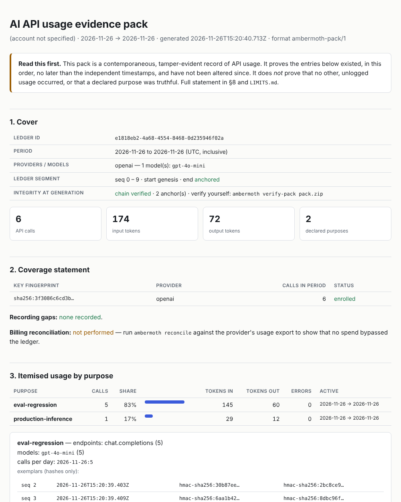

<p align="center">
  
</p>

<p align="center">
  <a href="https://github.com/devrdias/ambermoth/actions"></a>
  <a href="https://github.com/devrdias/ambermoth/releases/latest"></a>
  <a href="LICENSE"></a>
</p>

ambermoth is a local proxy that keeps a tamper-evident, hash-only record of your LLM API usage, and turns it
into an evidence pack anyone can verify offline.

## Why

Providers flag distillation by the shape of your traffic: high volume, repetitive prompts, a narrow set of
tasks. Nightly eval runs, prompt tuning and a leaked key all have that shape. When an account gets suspended
you have to explain the traffic fast, and a log you produce after the fact proves nothing.

ambermoth writes the record before anyone asks. Each call becomes an entry chained to the one before, and an
independent Time Stamping Authority (RFC 3161) timestamps the chain head. Prompts and outputs are stored only
as HMACs, so nothing sensitive leaves your machine. When someone asks, one command builds the pack and the
reviewer checks it without trusting you or us.

## What it proves

| Establishes | Does not establish |
|---|---|
| The entries existed, in this order, no later than the independent timestamps | That no other, unlogged usage happened (another key, another account) |
| They have not been altered since | That a purpose tag was truthful when it was written |
| Purposes and code links were recorded at the time, or their amendment is on record | That a provider must accept any of it |

Every pack includes this statement word for word.

## Quick start

Grab a binary from the [latest release](https://github.com/devrdias/ambermoth/releases/latest), or:

```sh
go install github.com/devrdias/ambermoth/cmd/ambermoth@latest
ambermoth init          # creates .ambermoth/ with a private HMAC key
ambermoth proxy         # listens on 127.0.0.1:8787
```

Point your SDKs at it:

```sh
export OPENAI_BASE_URL=http://127.0.0.1:8787/openai/v1
export ANTHROPIC_BASE_URL=http://127.0.0.1:8787/anthropic
# Gemini, via its OpenAI-compatible endpoint: http://127.0.0.1:8787/gemini/v1beta/openai
```

Tag traffic with a header, or set per-key and per-route defaults in `.ambermoth/config.json`. The proxy
strips every `X-Provenance-*` header before forwarding.

```python
client.messages.create(..., extra_headers={"X-Provenance-Purpose": "eval-regression"})
```

To try it without API keys, run `go run ./examples/mockprovider` (a fake OpenAI/Anthropic on :9999) and
point `.ambermoth/config.json` at `http://127.0.0.1:9999`.

## Usage

```sh
ambermoth link --purpose eval-regression --repo ./eval-harness   # run in CI on every harness change
ambermoth anchor                                                  # or set "anchor_interval": "1h"
ambermoth verify                                                  # chain + anchors
ambermoth alerts                                                  # volume spikes, narrow traffic, new keys
ambermoth key rotate --provider anthropic --reason "suspected leak" --replaced-by sha256:…
ambermoth amend --from-seq 120 --to-seq 340 --purpose eval-benchmark --reason "untagged nightly run" --by rafa
```

When you're asked to explain your usage:

```sh
ambermoth reconcile --provider anthropic --csv usage-export.csv   # show nothing bypassed the ledger
ambermoth pack --from 2026-10-01 --to 2026-11-25 --provider anthropic --account org_123 --out pack.zip
```

Write your explanation in `letter-template.md` and send the zip. Don't touch `summary.html`; the verifier
re-renders it from the ledger and rejects any change. The reviewer runs:

```console
$ ambermoth verify-pack pack.zip --report report.html
Evidence pack verification: OK
  files: 7 checked · totals recomputed from the ledger segment
  summary.html: identical to a re-render from the verified ledger
Ledger verification: OK
  anchors:   2, anchored through seq 3, 0 entries after the last anchor
```

FreeTSA and DigiCert roots are pinned in the binary. Tokens from any other authority fail unless the
reviewer passes `--tsa-ca root.pem` or `--allow-unpinned-tsa`.

<p align="center">
  
</p>

## How it works

<p align="center">
  
</p>

The proxy passes requests and responses through byte for byte, streaming included, and hashes them on the
way. If recording fails, traffic still flows and the gap is recorded. Each entry in `ledger.jsonl` holds the
hash of the previous one in canonical JSON, so changing any entry breaks every link after it. Only the hash
of the chain head is sent to the TSA.

One static binary, standard library only, and the verifier builds offline from this repo. The format and
verification algorithm are in [docs/SPEC.md](docs/SPEC.md); independent verifiers are welcome. Design
decisions are in [docs/adr](docs/adr/), diagrams in [docs/architecture](docs/architecture/).

## Status

Pre-1.0. The core works end to end: proxy, ledger, anchoring, packs and the verifier. Formats may still
change before v1.0. See the [roadmap](ROADMAP.md).

## Contributing

Read [CONTRIBUTING](CONTRIBUTING.md) and [docs/go-rules.md](docs/go-rules.md). The roadmap marks good first
tasks. Report vulnerabilities privately as described in [SECURITY](SECURITY.md).

## License

[MIT](LICENSE). The proxy, ledger and verifier will stay open source; being able to inspect them is what
makes the evidence credible.
