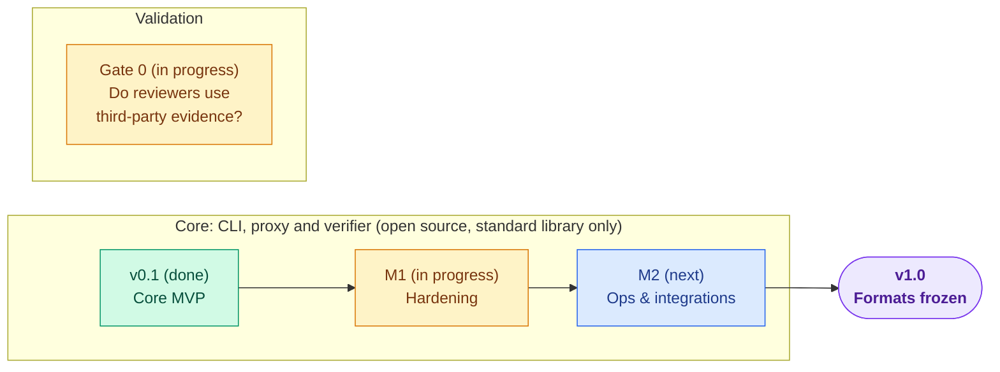
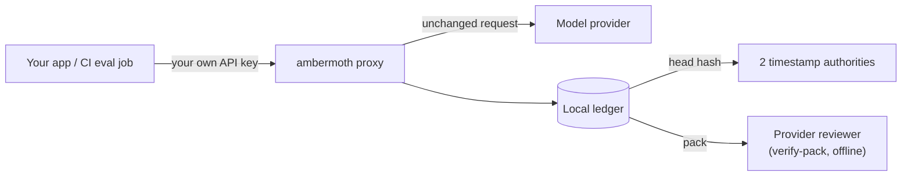

# Roadmap to v1.0

Where ambermoth is going, from the first release to a stable v1.0. It is built in the open. Every item below is an issue-sized piece of work, and the ones marked (good first task)
are self-contained. See [How to help](#how-to-help).

Each section is marked done, in progress, next or later.

## The path

The core stays a single offline binary with zero dependencies. Gate 0 decides what comes after v1.0.

## How it fits

---

## v0.1: Core MVP (done)

- [x] Proxy for OpenAI- and Anthropic-style APIs: SSE pass-through, fail-open, gap entries
- [x] Ledger: canonical JSONL, hash chain, per-entry HMACs, amendments, key events, code links
- [x] RFC 3161 anchoring with CMS signature check, two default TSAs (FreeTSA, DigiCert) and pinned roots
- [x] Evidence pack and `verify-pack` (totals recomputed, summary re-rendered, verifier report), `check-sample`
- [x] Anchor-lag reporting; self-attested labels on context entries
- [x] WebSocket (Realtime API) sessions recorded; graceful shutdown that records in-flight calls
- [x] CSV reconciliation, advisory alerts
- [x] Automatic releases from Conventional Commits (svu + GoReleaser), binaries for Linux, macOS and Windows

## M1: Hardening (in progress)

- [x] Go rules applied ([docs/go-rules.md](docs/go-rules.md)): rule checker clean, black-box tests, injected clock and logger
- [x] Every function under CRAP 10 (`make crap`)
- [x] CI runs `make rules`
- [x] Fix the WebSocket byte count test that fails now and then (`TestWebSocketUpgradeIsRecorded`)
- [x] `make lint` clean, and CI runs it
- [x] CI runs `make crap`
- [x] Benchmarks: proxy overhead p50 < 20 ms; pack build < 5 min for 1M entries
  - Proxy p50 overhead 0.12 ms at 1 KB; pack build of 1M entries in 107.5 s, peak heap 887.6 MB. See [docs/benchmarks.md](docs/benchmarks.md).
- [ ] `ambermoth repair`: recover a truncated last line after a crash, recorded as a gap entry
- [ ] Write-ahead durability mode
- [ ] External security review of the proxy
- [ ] `make diagrams` regenerates the architecture images from the LikeC4 model (good first task)

## M2: Ops and integrations (next)

- [ ] Docker image and systemd unit (good first task)
- [ ] Provider usage-export adapters: OpenAI usage API, Anthropic admin usage API
- [ ] Token usage from Realtime API frames (today: bytes and HMACs only)
- [ ] Full-chain packs (`--full-chain`)
- [ ] Publish the pack format as its own versioned spec and invite other tools to emit it

## Gate 0: Validation (in progress)

The open question is whether provider appeal and trust-and-safety teams look at third-party evidence at all. What
comes after v1.0 waits on the answer.

- [ ] Interview the HN poster (`weli`) and the commenter from the OpenAI case
- [ ] 5–10 more interviews ("20 minutes, no pitch")
- [ ] Read both providers' appeal paths. No fabricated disputes.

## v1.0: Stable (goal)

- [ ] Ledger format v1 and pack format v1 frozen: any change after this is a major version
- [ ] `verify-pack` keeps verifying every v1 pack ever produced
- [ ] Core security review closed

---

## How to help

Pick a task. Anything marked (good first task) is self-contained and a good start, but the rest is open too.
Comment on, or open, the matching issue so work isn't duplicated.

Read [CONTRIBUTING.md](CONTRIBUTING.md) for commits and releases, [docs/go-rules.md](docs/go-rules.md) for code
and [docs/SPEC.md](docs/SPEC.md) for formats.

Send a small PR: tests first, `make check`, `make rules` and `make crap` green, one Conventional Commit per change.

Changing a format (ledger or pack) or adding a dependency starts with a design note or an ADR in
`docs/`, before code.
