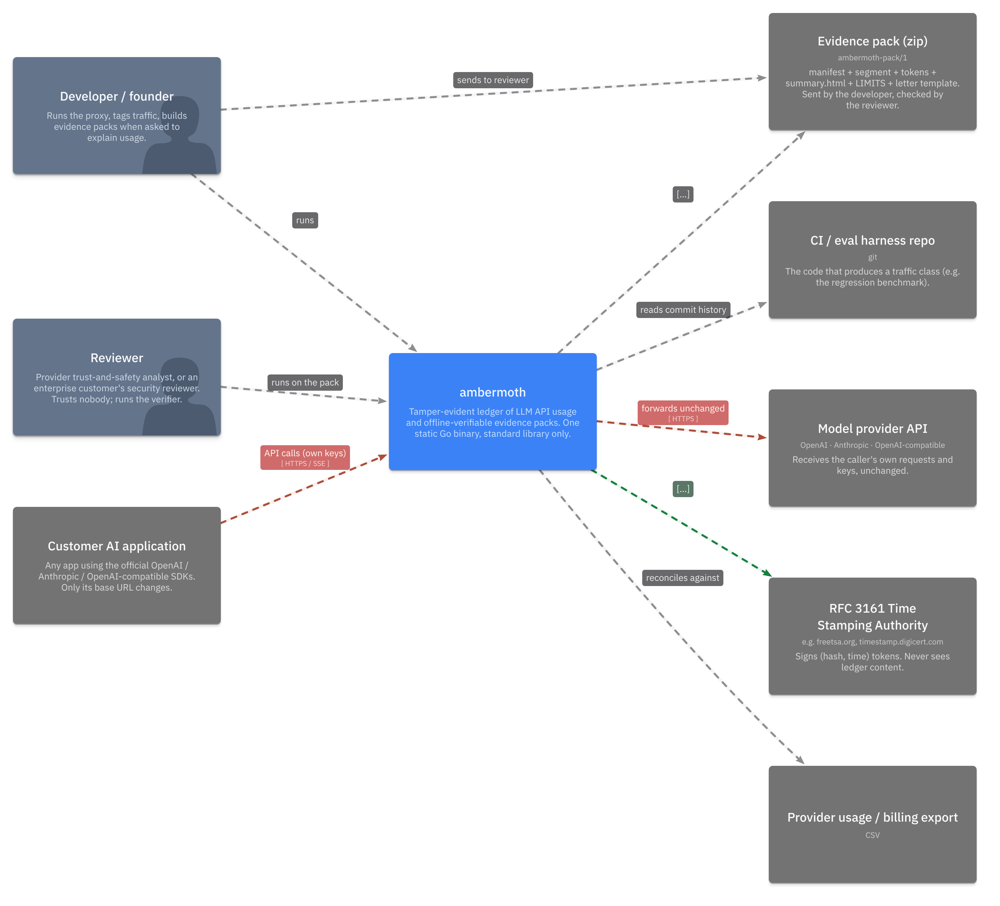
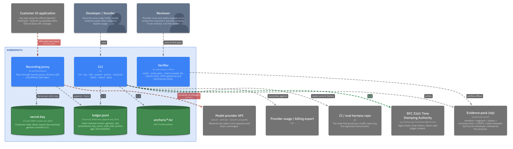
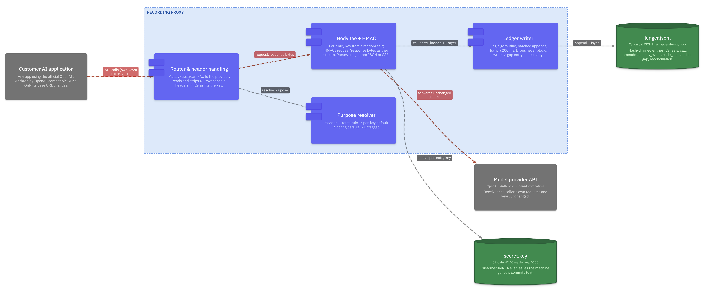
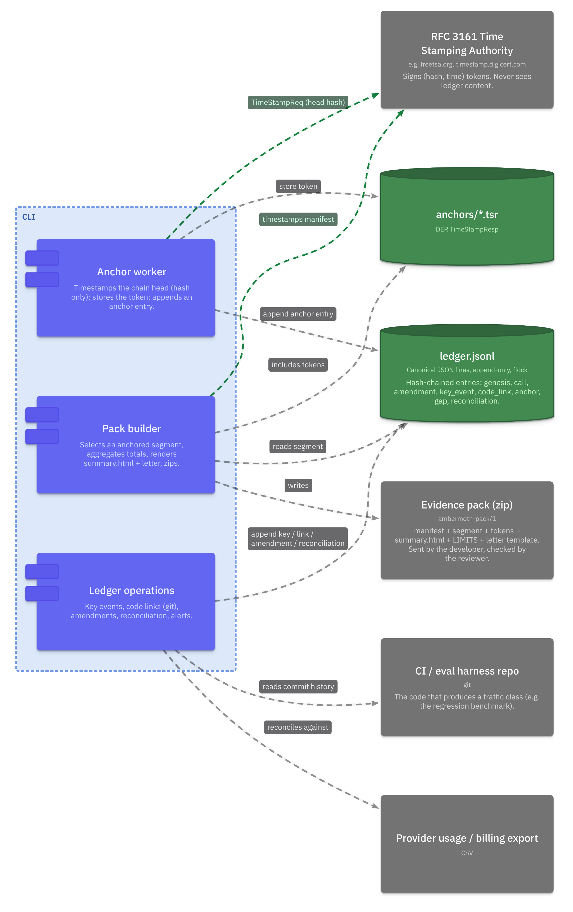
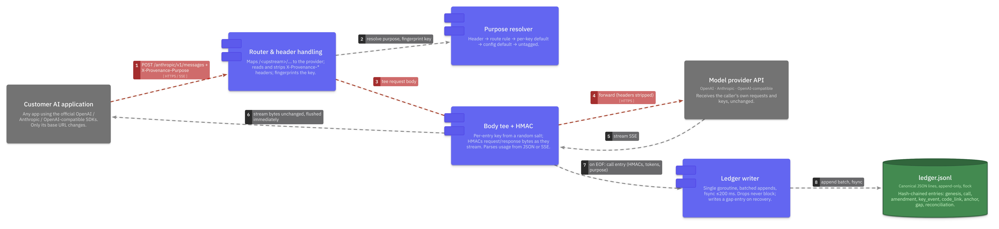
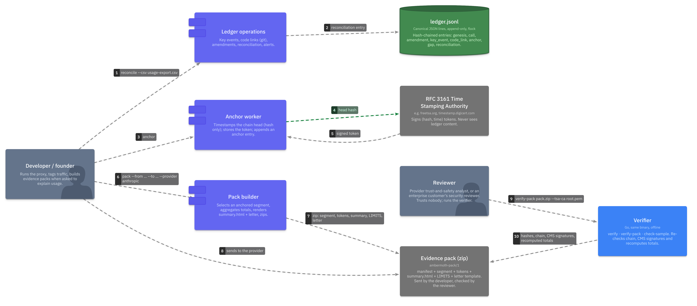

# Architecture (LikeC4)

The architecture is modelled as code with [LikeC4](https://github.com/likec4/likec4) (C4-style DSL).
The `.c4` files are the source of truth for the diagrams; `docs/SPEC.md` is the source of truth for behaviour. Keep them in sync.

| File | Contents |
|---|---|
| `spec.c4` | Element/relationship kinds. Red edges carry API keys or content; green dashed edges send hashes only. |
| `model.c4` | People, external systems, the ambermoth containers and components, relationships. |
| `views.c4` | Context, containers, proxy, CLI, and two dynamic flows (recording a call, answering a flag). |

## Views

| View | Image |
|---|---|
| System context |  |
| Containers |  |
| Proxy components |  |
| CLI components |  |
| Recording one call |  |
| Answering a distillation flag |  |

## Working on it

Node is only needed for the diagrams. The Go build never depends on it.

```sh
npx likec4@1.61.1 start docs/architecture                                  # live preview, http://localhost:5173
npx likec4@1.61.1 validate --json --no-layout docs/architecture            # what CI runs
npx playwright install chromium                                            # once, for PNG export
npx likec4@1.61.1 export png --flat -o docs/architecture/images docs/architecture
```

`likec4 export png --seq` renders the dynamic views as UML sequence diagrams instead.
